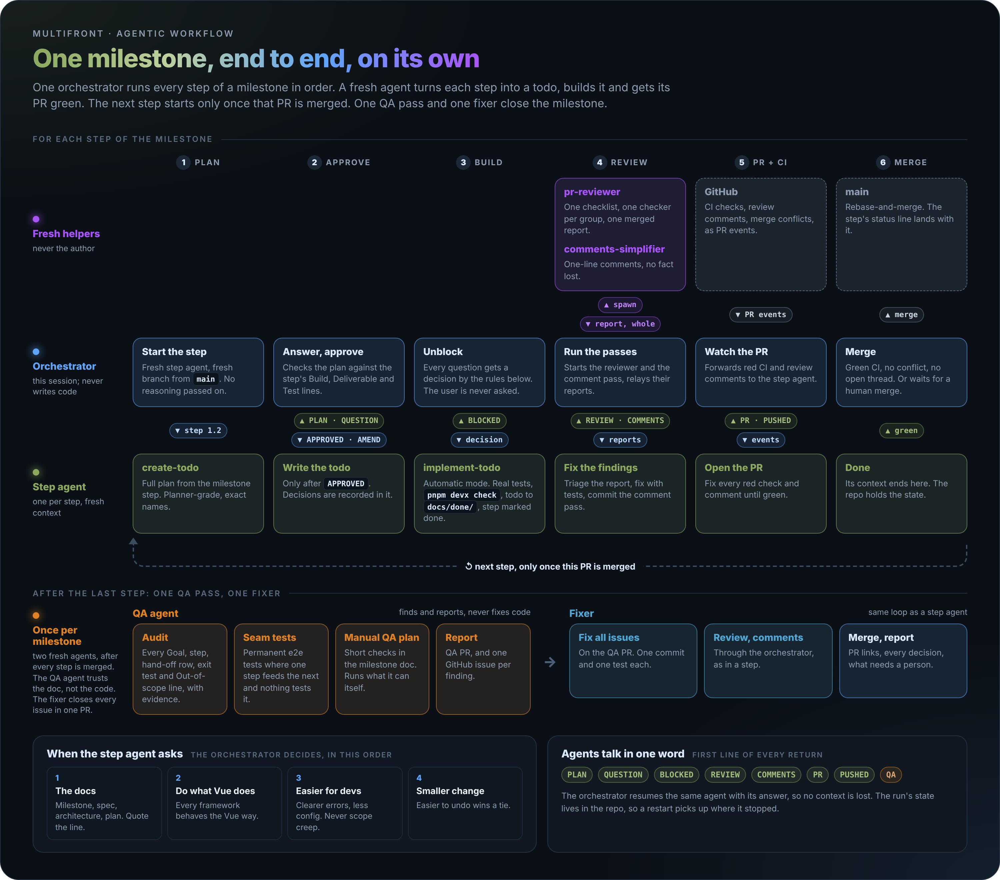

# run-milestone

Use [the tool mapping](../TOOLS.md) for assistant-specific calls and fallbacks.

You are the **orchestrator**. You never write product code. You read the milestone, start one agent per step, answer its questions, run the independent passes it cannot run itself, watch its PR and merge it. When every step is merged, one QA agent checks the whole milestone and one fixer closes what it found.



| Role | Who | Instructions |
| --- | --- | --- |
| Orchestrator | this session | this file |
| Step agent | `milestone-step`, one per step, fresh | [step.md](step.md), "Step mode" |
| QA agent | `milestone-qa`, one per milestone, fresh | [qa.md](qa.md) |
| Fixer | `milestone-step`, one per milestone, fresh | [step.md](step.md), "Fix mode" |
| Reviewer, comment pass | `pr-reviewer`, `comments-simplifier` | the review-pr and simplify-comments skills |

Effort is never set here: every agent inherits the effort of the session the user started.

## The rules of the run

- **One step at a time.** Step N+1 starts only once step N's PR is merged. Steps build on each other's code.
- **You stand in for the user.** create-todo and implement-todo ask the user to approve and decide. In this run the step agent asks you, and you answer by the decision rules below. You never pass a question on to the user.
- **The user is asked twice at most**, both at the start (step 0). After that the run goes on alone. It stops for the user only when it cannot go on: missing access, a host that cannot run the gate, or an action that cannot be undone and the user did not authorise.
- **Agents talk through their final message.** A step agent ends every turn with a status keyword (table in step 2) and you resume it with SendMessage, so it keeps its context. A fresh Agent call would lose it.
- **Keep your own context small.** Do not read diffs or code. Your inputs are the docs, the agents' status messages and the PR state. A fresh agent judges code better than you do anyway.

## Step 0: Start

Ask once, in one question round, only what the request did not say:

1. **Which milestone**: a file in `docs/milestones/`.
2. **Who merges**: *auto* (you rebase-and-merge each PR once it is done, as defined in step 3) or *human* (you wait for the user to merge each PR).

Then read: `AGENTS.md`, `docs/milestones/README.md` (its "Shared names and fixtures" wins over a milestone doc), the milestone doc in full, and `docs/spec.md`, `docs/architecture.md`, `docs/plan.md`. These are what you answer questions from.

Check the host can run the gate (`pnpm devx check`, see SETUP.md). If it cannot and you cannot fix that, stop and tell the user: no step can pass without it.

## Step 1: Find where the run is

The run must survive a restart, so its state lives in the repo and on GitHub, never only in your memory:

- A step is **done** when its heading in the milestone doc on `origin/main` carries a `- Status: done` line (the step agent adds it in its PR).
- A step is **in flight** when an open PR's branch is `feature/m<N>.<k>-*`. Resume its agent if you still have it; otherwise start a fresh step agent on that branch and tell it the PR exists.
- The QA pass is **done** when the milestone doc has a `## Manual QA` section on `origin/main`.

Start from the first step that is not done. Tell the user in one line where the run starts.

## Step 2: Run one step

1. **Clean start.** The working tree is clean and `origin/main` is fetched. The branch is `feature/m<N>.<k>-<slug>`, cut from `origin/main`. If the host pins this session to one branch name, use that name for every step and reset it to `origin/main` only after the previous step's PR is merged.
2. **Spawn the step agent** (`milestone-step`). Give it only this; your own reasoning stays out:

   ```
   Step mode. Milestone: docs/milestones/<file>.md, step <N.k>.
   Branch: <branch>, cut from origin/main.
   Follow .agents/skills/run-milestone/step.md, "Step mode".
   ```

3. **Answer every return** until the step is merged. The first line of each return is one keyword:

   | Keyword | It means | You do |
   | --- | --- | --- |
   | `PLAN` | the drafted full-plan todo, ready for approval | check it (below), then reply `APPROVED` or `AMEND: <changes>` |
   | `QUESTION` | a fork the docs did not settle | reply with a decision (decision rules) |
   | `BLOCKED` | it cannot go on | remove the blocker, or decide around it |
   | `REVIEW` | the gate is green, it needs the review | run the review (below), send the whole report |
   | `COMMENTS <files>` | it needs the comment pass | run the comment pass (below), send the whole report |
   | `PR <url>` | the PR is open | watch it (step 3) |
   | `PUSHED <sha>` | it pushed a fix you asked for | keep watching |

   **Checking a `PLAN`.** Compare it with the step's Build, Deliverable and Test lines, line by line. Every name and shape is exact, every test follows the testing rules (real files, real tools, no mocks), the step's Out of scope and the milestone's are respected, and the plan names the docs it changes. Anything missing is an `AMEND`. A plan that adds work the step does not ask for is an `AMEND` too.

   **Running the review.** The step agent cannot always start agents, so you run the calling half of the review-pr skill for it, steps 2 to 4: spawn the `pr-reviewer` on the step's branch, fan the groups out, get the merged report. Do not triage it: send it whole to the step agent, which triages and fixes in automatic mode. If the step agent can start agents itself, it runs the review alone and never sends `REVIEW`.

   **Running the comment pass.** Spawn a `comments-simplifier` with the file list and the instruction to read `.agents/skills/simplify-comments/SKILL.md` first. Send its report whole to the step agent, which checks it against the code and commits it.

## Step 3: Watch the PR, then merge

Subscribe to the PR's activity (the tool mapping, "Pull requests and CI"). Subagents get no PR events, so you are their eyes:

- **Red CI, a review comment, a merge conflict**: send the event to the step agent as it came, with "fix and push". It replies `PUSHED <sha>`.
- **Done** means: CI green on the latest commit, no merge conflict, no open review thread, and the Claude Approvals check passing where the repo runs it.
- **Auto merge**: merge it with the rebase method (AGENTS.md: PRs land with rebase-and-merge). **Human merge**: say once that the PR is ready and wait for its merged event.
- After the merge: fetch `origin/main` and check the step's `- Status: done` line is there. Then go to step 2 with the next step.

## Step 4: QA, once for the whole milestone

When every step is merged, spawn one `milestone-qa`:

```
Milestone: docs/milestones/<file>.md. Every step is merged on origin/main.
Branch: chore/m<N>-qa, cut from origin/main.
Follow .agents/skills/run-milestone/qa.md.
```

It returns `QA <pr-url>` with one GitHub issue per finding, or `QA CLEAN <pr-url>`. If it could not create issues, it returns them as text: create them yourself, as it wrote them.

## Step 5: One fixer for every finding

Spawn one `milestone-step` in fix mode, even when QA was clean (the QA PR still has to go green and merge):

```
Fix mode. Milestone: docs/milestones/<file>.md.
QA PR: <url> on branch chore/m<N>-qa. Issues: #<a>, #<b>, ...
Follow .agents/skills/run-milestone/step.md, "Fix mode".
```

Answer it exactly as in step 2, then watch and merge its PR as in step 3.

## Step 6: Close the milestone

Fetch `origin/main` and check: every step has `- Status: done`, the `## Manual QA` section is there, every QA issue is closed. Then tell the user, short:

- the merged PRs, one link each;
- every decision you made in answer to a `QUESTION`, one line each (each also lives in its step's todo, now in `docs/done/`);
- the todos filed for unrelated findings (below), and the manual QA checks left for a person.

## Decision rules

Every `QUESTION`, `BLOCKED` and `AMEND` is answered by the first rule that settles it. Quote the line that settled it.

1. **The docs.** The milestone doc, then `docs/milestones/README.md` (it wins over the milestone doc), `docs/spec.md`, `docs/architecture.md`, `docs/plan.md`, AGENTS.md.
2. **Do what Vue does.** multifront builds one component for several frameworks, and they must all behave the Vue way. When the docs are silent, copy what Vue, plugin-vue or `@vue/compiler-sfc` do, and name where.
3. **Make the developer's life easier.** Pick the option with the clearer error, less config, fewer surprises for whoever uses multifront. Unless it adds work the step does not ask for: scope creep loses.
4. **Still a tie**: the smaller change that is easier to undo.

Your answer always carries: the decision, the rule and line that settled it, and which doc changes because of it (the step agent edits it in the same PR). If a decision changes a name or shape in the milestone's "Hands to later milestones" table, the step agent also updates every later milestone doc that uses it.

## Findings off the step's path

A step agent never starts sessions. An unrelated finding becomes a guidelines todo in its PR, named in its `PR` message. Once that PR is merged, run the [delegate-finding skill](../delegate-finding/) for it if you can start background sessions. Otherwise it stays in `docs/todos/` and goes in the step 6 report.

## What NOT to do

- **Do not write code, review code or fix findings yourself.** Every one of those has its own agent.
- **Do not start a step before the previous step's PR is merged**, and never run two step agents at once.
- **Do not ask the user what the decision rules can answer.**
- **Do not filter a review or comment report** before it reaches the step agent.
- **Do not merge a PR that is not done** (step 3), and in human merge mode never merge at all.
- **Do not give an agent your reasoning or another agent's context.** A fresh agent with only its prompt is the point.
- **Do not set an agent's effort.** It comes from the session the user started.
