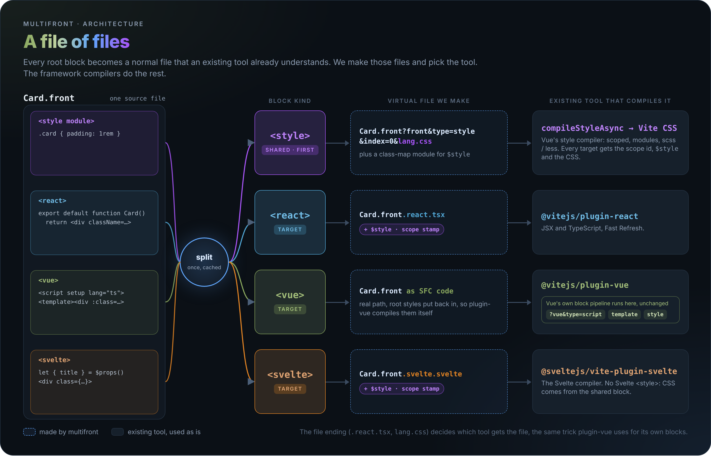
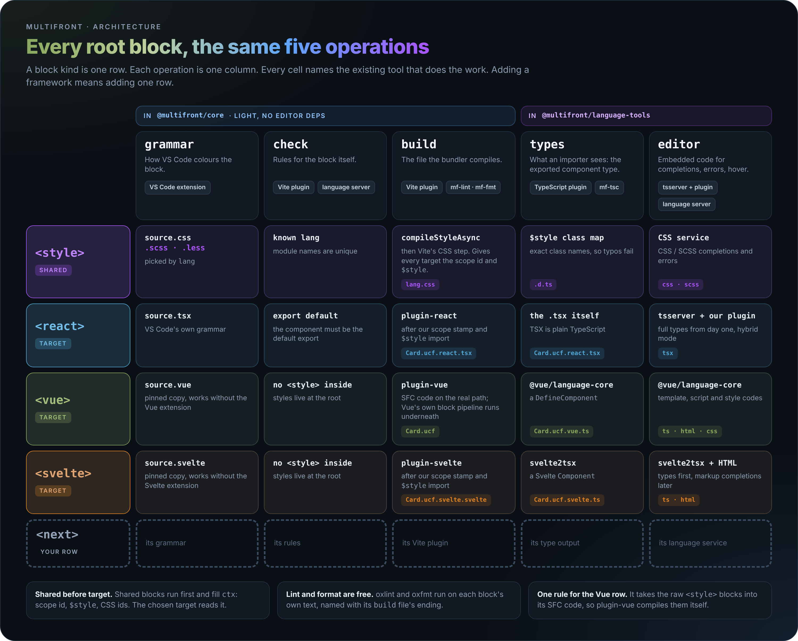
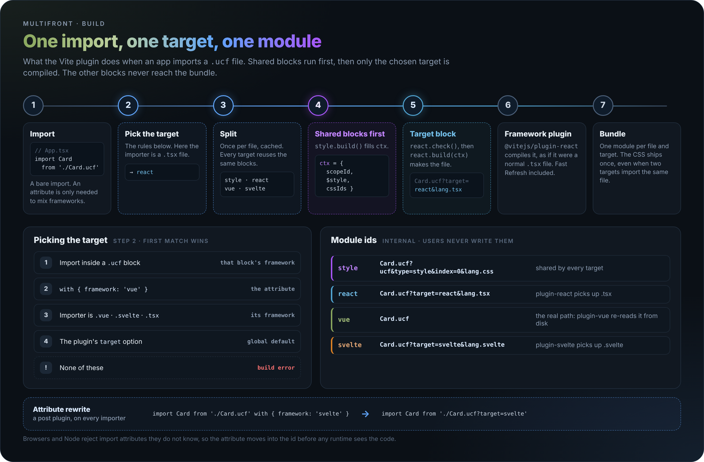
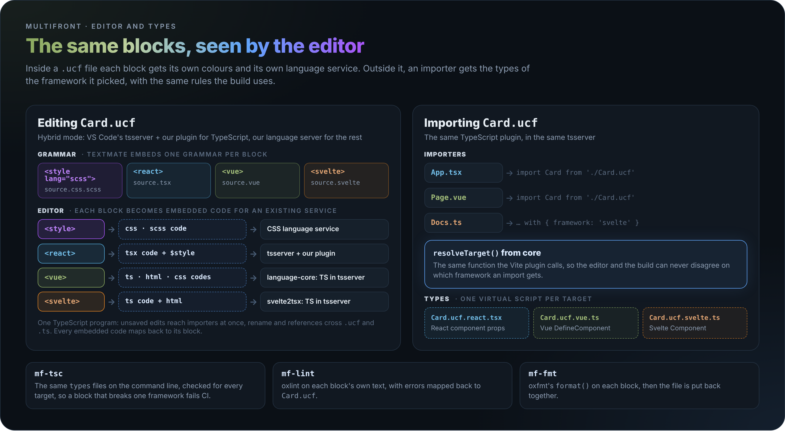

# Architecture

How multifront turns one `.ucf` file into a Vue, React or Svelte component, for the bundler and for the editor. What we build: [spec.md](spec.md). In which order: [plan.md](plan.md).



## The idea

Every root block becomes a normal file that an existing tool already understands, with a map back to the original lines.

- We write no compilers and no language services.
- We make those virtual files and pick the tool for each one.
- The file ending picks the tool: `Card.ucf.react.tsx` goes to plugin-react, `?…&lang.css` to Vite's CSS step.

## Where we sit next to Vue

A Vue single file component is already a file of files:

1. `compiler-sfc` `parse()` splits `Card.vue` into script, template and style blocks.
2. plugin-vue turns each block into a sub-module, like `Card.vue?vue&type=style&index=0&lang.scss`. The `lang.scss` ending lets Vite's normal plugins compile it.
3. In the editor, `@vue/language-core` splits the same way and hands each block to the TypeScript, HTML or CSS service as "embedded code".

We add the same layer **one level higher**: a `.ucf` file is a file of components. For the `<vue>` block, what we make is plain Vue SFC code, so Vue's whole pipeline runs unchanged underneath ours.

## Block kinds

Every root tag, `<style>` included, is a **block kind** with the same five operations:

```ts
// Core half: packages/core/src/blocks/index.ts, BLOCK_KINDS
interface BlockKind {
  tag: 'react' | 'vue' | 'svelte' | 'style';
  role: 'target' | 'shared';         // target = a framework component, shared = used by every target
  grammar: {scopeName, languageId, byLang?}; // VS Code highlighting; byLang picked by <style lang>
  check(block, split): Diagnostic[]; // rules for the block, e.g. "react must export default"
  fillContext?(blocks, ctx): Promise<void>; // shared kinds only: fill ctx before any build
  build(block, ctx): VirtualFile;    // the file the bundler compiles
}

// Language-tools half: packages/language-tools/src/blocks/index.ts, same tags, same order
interface EditorBlockKind {
  tag: 'react' | 'vue' | 'svelte' | 'style';
  types?(block, ctx): EditorFile | undefined; // the file TypeScript reads: what the module exports
  editor?(block, ctx): EditorCode[];  // embedded codes for tsserver (TypeScript) and our language server (the rest)
  serviceScript?(code): TargetScript | undefined; // the script tsserver serves as Card.ucf.<tag>.ts (vue, svelte)
}
type EditorCode = EditorFile | VirtualCode; // <vue>: a VueVirtualCode from @vue/language-core

interface VirtualFile {
  ext: '.tsx' | '.vue' | '.svelte' | '.css' | '.scss' | '.ts';
  code: string;
  map: SourceMap | undefined; // back to the block in the .ucf file
}

interface EditorFile extends VirtualFile {
  mappings: CodeMapping[]; // Volar mappings with per-span feature flags; map stays undefined
}
```

- **Shared blocks run first** and fill `ctx`: the scope id, the `$style` class map and the CSS module ids. `createBuildContext()` in core calls each shared kind's `fillContext`, in registry order. The chosen target reads `ctx`. The editor does the same synchronously: the style row's `editor()` fills `ctx.modules` with the CSS module keys before the target rows' `types()` read them.
- **Lint and format need no operation of their own.** oxlint and oxfmt run on each block's own text, named with the ending of its `build` file (`.tsx`, `.vue`, `.svelte`) or its style `lang`. They never see generated code, so nothing generated is ever written back into a `.ucf` file.
- **One rule for the Vue row:** it takes the raw `<style>` blocks into its SFC code, so plugin-vue compiles them itself. React and Svelte use the compiled CSS from `ctx`.

## The grid

A block kind is a row, an operation is a column, and each cell names the existing tool that does the work.



### Adding a block kind

1. A new framework (Solid, say) is a `target` row: its grammar, its rules, its Vite plugin, its type output, its language service.
2. A new shared block (a `<types>` block, say) is a `shared` row that adds values to `ctx`.
3. Add the row to the registry in both packages (see below). A test fails if a tag has only one half.

Nothing else changes: the hosts loop over the registry.

## Hosts

A host is a program that runs the operations. Each one does the same three steps: split the file once (cached), pick the target, ask the block kinds for the files it needs.

| Host | Package | Operations it calls |
| --- | --- | --- |
| Vite plugin | `@multifront/vite` | `check`, `build` |
| Language server | `@multifront/language-tools` | `check`, `editor` (CSS, template HTML) |
| TypeScript plugin (in VS Code's tsserver), `mf-tsc` | `@multifront/language-tools` | `types`, `editor` (TypeScript codes) |
| `mf-lint`, `mf-fmt` | `@multifront/language-tools` | the block text, named by `build`'s ending |
| VS Code extension | `packages/vscode` | `grammar`, at packaging time; starts the language server and VS Code's TypeScript extension, bundles the server and the TypeScript plugin |

## Build

What the Vite plugin does when an app imports a `.ucf` file. Only the chosen target is compiled; the other blocks never reach the bundle.



- The target rules are spec section 4. They live in one function, `resolveTarget()` in core.
- The Vue target keeps the real file path as its module id, because plugin-vue re-reads the file from disk on a cache miss. Details in [plan.md](plan.md), "Building on plugin-vue".
- Browsers and Node reject unknown import attributes, so a post plugin moves `with { framework }` into the module id before any runtime sees it.
- The React and Svelte scope transforms call a forwarding helper the Vite plugin serves as the virtual module `virtual:multifront/scope-attrs`, so a build bundles it once and components need no runtime package.

## Editor and types



- **Highlighting:** VS Code TextMate grammars can embed another language between a begin and an end tag; Vue's extension does this for `<style lang="scss">`. Our grammar is generated from the registry, one rule per tag. The extension bundles pinned copies of the Vue and Svelte grammars (both MIT), so it works without their extensions installed. The copies are served under our own scopes (`source.ucf.vue`, `source.ucf.svelte`, `source.ucf.vue.vue.*`), so they never clash with those extensions. VS Code reads injections only from the document's root grammar, so their injections move to `source.ucf`, each one limited to its own block.
- **Hybrid mode:** VS Code's own tsserver, with our TypeScript plugin, does every TypeScript job, inside `.ucf` files too. So there is one TypeScript program: unsaved edits reach importers at once, and rename and references cross file kinds. Our language server does the rest.
- **Inside a `.ucf` file:** each block's `editor()` codes go to tsserver (TypeScript) and to our language server (CSS, template HTML), which asks tsserver when it needs types. The `<vue>` block's code is a real `VueVirtualCode` from `@vue/language-core`, nested under our root code, so Vue's own template services run on it; the root forwards the fields they read to it. They ask tsserver through a relay: the server sends each request to the extension, which runs it through VS Code's `typescript.tsserverRequest`, and our TypeScript plugin answers it with Vue's own request functions on that nested code.
- **Importing a `.ucf` file:** TypeScript never reads import attributes, so our TypeScript plugin resolves `./Card.ucf` with `resolveTarget()`, the same function the build uses (and reads a non-literal attribute as an error with the build's `rewriteImportAttributes()`), and points it at that target's `types()` script. Volar's tsserver plugin serves one script per `.ucf` file, the React one. Every other target with a `serviceScript` becomes a program file of its own, `Card.ucf.vue.ts` or `Card.ucf.svelte.ts` (svelte2tsx's script, with the project's own Svelte compiler), that our plugin serves through the project host. Any importer's pick of that target resolves to it, and the program then holds the `.ucf` file too, so an edit of it reaches the importer. Requests inside that block, and its diagnostics, go to it through a second Volar language whose code maps into the `.ucf` file. Definitions and references that land in it, from any file, map back into the `.ucf` file the same way. Beside another tsserver plugin on the same host (Vue's, for `.vue` importers), our `.ucf` resolver stays outermost in either load order, and the plugin keeps its decoration record and diagnostic objects its own, so the two also work from one shared `@volar/typescript` copy.
- **Packaging:** `pnpm devx vsix` bundles the extension, the language server and the TypeScript plugin, so the `.vsix` needs nothing else installed. Core parses `<react>` with oxc-parser, which the bundles load through its wasm binding: one `.vsix` serves every platform. tsserver finds a plugin only in an extension's own `node_modules`, so the plugin ships there as a pack (a file that loads the bundle). Every Vue script references `@vue/language-core`'s global types by path, which a bundle loses: the `.vsix` ships a copy of them in `dist/vue-types/`, and the bundled plugin points `vueTypesRoot` there. Every Svelte script references svelte2tsx's shims the same way (`dist/svelte-types/`, `svelteTypesRoot`). svelte2tsx imports TypeScript and Svelte's compiler itself, and the `.vsix` ships neither: in the bundles its TypeScript is the copy tsserver hands the plugin, and its compiler a stub, since we always pass the project's `parse`. When a project also lists its own installed plugin and VS Code runs the workspace TypeScript, both copies load: the first one in a project serves it, the other steps aside.

## Where the code lives

`@vue/language-core` and `svelte2tsx` are heavy and must stay out of a build. So each block kind is two files with the same name, one per package:

```
packages/core/src/blocks/
  index.ts          the registry: every BlockKind, in order (shared first)
  style.ts          check · build · grammar
  react.ts
  vue.ts
  svelte.ts
packages/language-tools/src/blocks/
  index.ts          the same tags, editor halves
  style.ts          editor
  react.ts
  vue.ts
  svelte.ts
```

React-only transforms (the scope transform) live in `packages/core/src/react/`; every React API name they look for is in `reactApis.ts`.

## Updating the graphics

The images are HTML pages under [assets/src/](assets/src/), styled with the mion website palette in [assets/src/theme.css](assets/src/theme.css): olive for Vue, blue for React, orange for Svelte, purple for styles. Edit a page, then render it to PNG:

```bash
pnpm devx docs-images            # every page
pnpm devx docs-images grid       # one page
```

Commit the HTML and the PNG together.
