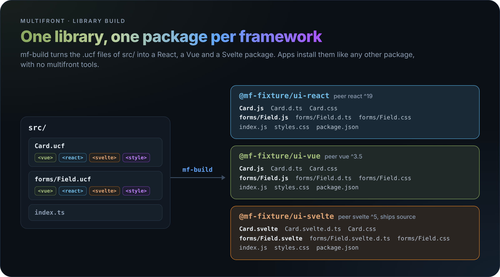

# Building a Library

Build a folder of `.ucf` files into one npm package per framework. Apps install the packages like any other, with no multifront tools.

## Setting Up a Library

Put the components in `src/`, and name each package in `multifront.config.ts` beside the library's `package.json`.

`multifront.config.ts`

```ts
import {defineLibrary} from '@multifront/vite';

export default defineLibrary({
  packages: {react: {name: '@mf-fixture/ui-react'}, vue: {name: '@mf-fixture/ui-vue'}, svelte: {name: '@mf-fixture/ui-svelte'}},
});
```

The library installs what an app needs for each framework it builds ([Getting Started](01-getting-started.md#setting-up-vite)), plus the tools that write the types:

| Package | Version | For |
| --- | --- | --- |
| `typescript` | `^6.0.0` | every package's types |
| `@multifront/language-tools` | the same as `@multifront/vite` | React and Svelte types |
| `vue-tsc` | `^3.3.11` | Vue types |

## Running the Build

Run `mf-build` in the library folder. It reads `multifront.config.ts` (or `.js`, `.mjs`), writes one package per framework under `dist/` and prints a line for each.

```bash
pnpm exec mf-build
```

A component with no block for a framework is left out of that package, and the line names it: `react: 49 files in dist/react (@mf-fixture/ui-react), skipped VueOnly.ucf`.

## Build Options

Set options in `defineLibrary()`. Some also have a flag, which wins over the config.

| Option | Flag | Does | Default |
| --- | --- | --- | --- |
| `packages` | | Each package's `name`, and `peers` ranges added to or replacing the defaults | the library's name plus `-react`, `-vue` or `-svelte` |
| `frameworks` | `--framework <name>`, repeatable | Builds only these frameworks | every framework a component has a block for |
| `outDir` | `--out-dir <folder>` | Where the packages go, one folder per framework | `dist` |
| `dts` | `--no-dts` | `false` writes no `.d.ts` files and needs none of the type tools | `true` |
| `root` | `--root <folder>` | The library folder | the current folder |
| `src` | | The components folder | `src` |
| `index` | | The package's main entry, or `false` for none | `src/index.ts` when it exists |
| `vite` | | Vite config merged into every framework's build | |

## What Each Package Holds

Each component becomes its own file and keeps its folder: `src/forms/Field.ucf` becomes `forms/Field.js`, with its types and its CSS beside it.



| Package | Per component | Peer dependencies |
| --- | --- | --- |
| React | `Card.js`, `Card.d.ts`, `Card.css` | `react`, `react-dom` `^19.0.0` |
| Vue | `Card.js`, `Card.d.ts`, `Card.css` | `vue` `^3.5.0` |
| Svelte | `Card.svelte`, `Card.svelte.d.ts`, `Card.css` | `svelte` `^5.0.0` |

Each package also holds `index.js` from `src/index.ts`, the plain `.ts` files the components import as `.js`, `styles.css` with every component's CSS, and the library's `README.md` and `LICENSE`. Its `package.json` copies `version`, `description`, `license`, `author`, `repository`, `homepage` and `keywords` from the library's, and lists peer dependencies only.

> **Note:** The Svelte package ships each component uncompiled, as `svelte-package` does, so the app's own Svelte compiler builds it. Plain `.svelte` files and `.svelte.ts` modules the components import ship the same way, `.svelte.ts` as `.svelte.js` with its types stripped. Every shipped `.svelte` file goes through the preprocessors of the library's `svelte.config.js`.

## Using a Package in an App

Install the package, then import components from its main entry or each from its own path.

`App.vue`

```vue
<script setup lang="ts">
import {Button, Card, Counter} from '@mf-fixture/ui-vue';
import VueOnly from '@mf-fixture/ui-vue/VueOnly';
</script>

<template>
  <main>
    <Card title="Hello">
      <Counter />
    </Card>
    <VueOnly />
  </main>
</template>
```

| Package | Works in |
| --- | --- |
| React | Vite, Next.js App Router |
| Vue | Vite |
| Svelte | SvelteKit |

> **Tip:** One `src/index.ts` serves every package, so export from it only components with every framework's block. Import the others from their own path, as `VueOnly` here.

## Loading Every Style at Once

Each component's file imports its own CSS, so an app's bundle holds the CSS of the components it imports and no more. To load the CSS of every component, import `styles.css`.

`styles.ts`

```ts
import '@mf-fixture/ui-vue/styles.css';
import {createApp, h} from 'vue';
import {Card} from '@mf-fixture/ui-vue';

createApp({render: () => h(Card, {title: 'Styles'})}).mount('#app');
```

## Server Components in Next.js

A React component starts with `"use client"` when its `<react>` block calls a hook, has an event handler, calls `createContext` or defines a class component. So a Next.js server component can render every component of the package.

`app/page.tsx`

```tsx
import {Button, Card, Panel, Tooltip} from '@mf-fixture/ui-react';
import Field from '@mf-fixture/ui-react/forms/Field';

export default function Page() {
  return (
    <main>
      <Card title="Hello">
        <Panel heading="Inside" />
      </Card>
      <Button label="Go" className="extra" style={{color: 'red'}} />
      <Tooltip text="More">Hover me</Tooltip>
      <Field label="Name" />
    </main>
  );
}
```

> **Tip:** To mark a component that needs the browser in another way, start its `<react>` block with `'use client'`. That line is always kept.

## Fixing a Failed Build

`mf-build` stops at the first problem and prints it after `mf-build:`.

| Message | Fix |
| --- | --- |
| `"left-pad" is imported by src/utils/cx.ts, but it is not a peer dependency of …` | Add the package to `packages.<framework>.peers`, so the app installs it, or drop the import. |
| `the react types need typescript; install it, or set dts: false` | Install the package the message names in the library. |
| `the react types do not compile: src/Card.ucf: error TS2322 …` | Fix the type error in that file. |
| `src/utils/cx.css is imported by src/utils/cx.ts: a library package ships CSS from .ucf <style> blocks only` | Move the CSS into a `<style>` block. |
| `src/Card.ucf imports "~/utils/cx.js" in its <svelte> block: a shipped svelte file can import relative files and peers only`, or the same for a plain `src/Child.svelte` | Import the file by its relative path. |
| `src/Child.ucf and src/Child.svelte would both be written as Child.svelte` | Rename one of the two files. |
| `shared/tokens.ts is outside src` | Move the file into `src`. |
| `package.json has no name; set packages.vue.name` | Name the library, or set that package's `name`. |
| `src/Badge.ts and src/Badge.ucf would both be written as Badge.js` | Rename one of the two files. |
| `src/styles.ucf would be written as styles.css, the name of the combined CSS file` | Rename the component. |
