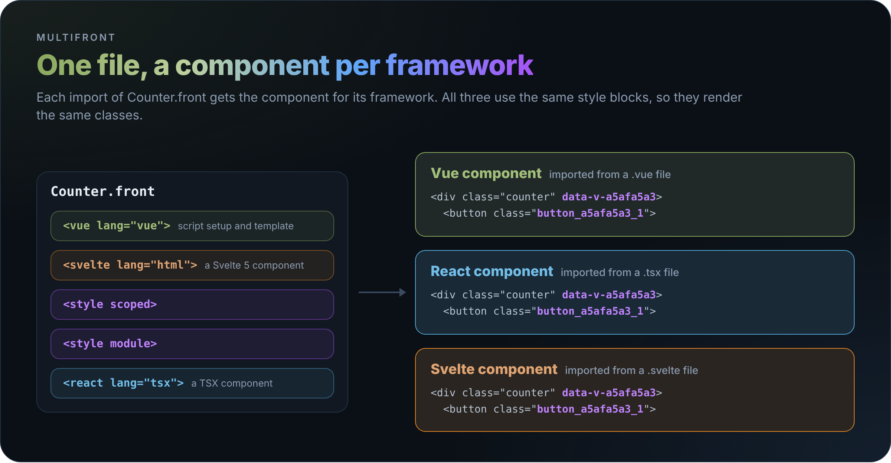

# multifront

Write one component file with a Vue, a React and a Svelte version side by side, and styles they all share. multifront builds each version with Vite, and VS Code understands the whole file.

## Pages

- [Getting Started](01-getting-started.md): the Vite setup and a first component, in React, Vue and Svelte.
- [Component Files](02-component-files.md): the blocks of a `.front` file and their rules.
- [Styles](03-styles.md): style blocks, `$style` and scoped styles across components.
- [Imports](04-imports.md): which framework an import of a `.front` file gets, and several frameworks in one app.
- [Editor Setup](05-editor-setup.md): the VS Code extension, and the `mf-tsc`, `mf-lint` and `mf-fmt` checks.
- [Building a Library](06-building-a-library.md): one npm package per framework, and using them in apps.
- [Errors](07-errors.md): every error code and its fix.
